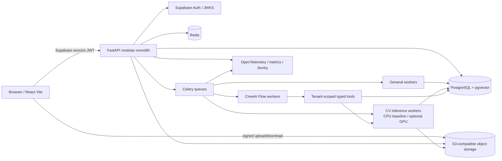
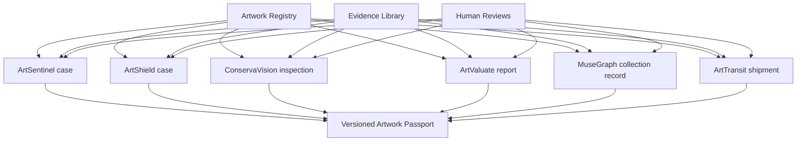
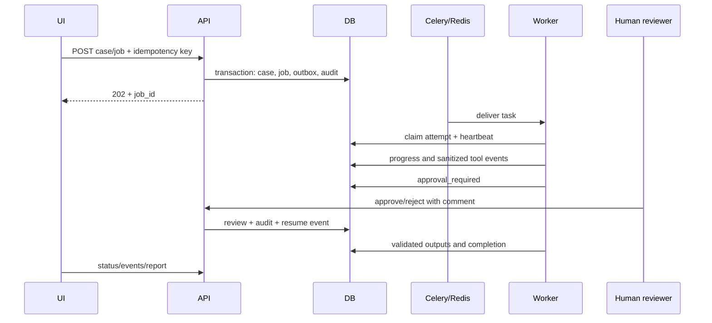
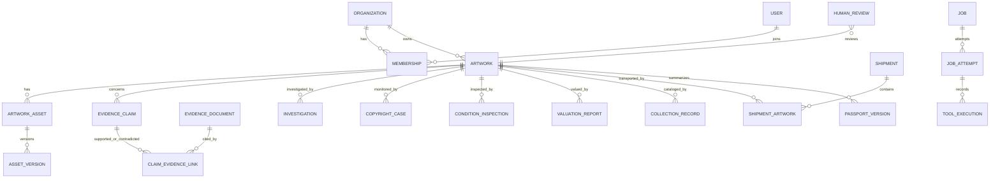
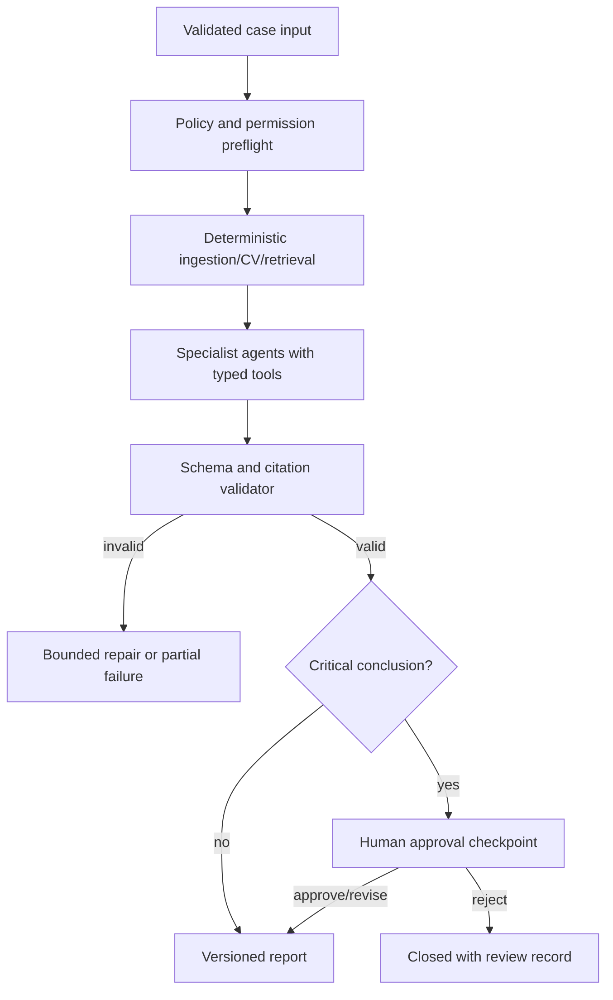
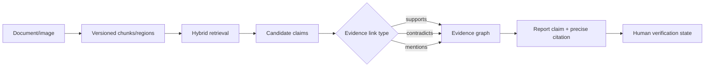

# VERNIS Master Rebuild Plan

Status: Phase 0 approved; Phase 1 foundation implemented for review on 2026-10-23

Prepared: 2026-10-23

Product: **VERNIS — The Art Intelligence Operating System**

## 1. Executive decision

Vernis should be rebuilt as a modular monolith with one canonical artwork registry, one evidence model, one asynchronous job platform, and six independently entitled intelligence engines. React/Vite remains the client. FastAPI becomes the authoritative application and authorization boundary. PostgreSQL with pgvector is the system of record; Redis and Celery provide durable work execution; S3-compatible object storage holds private originals and derived artifacts. CrewAI Flows coordinate domain crews but never replace deterministic authorization, evidence validation, or human approval.

The existing repository is a useful visual and integration prototype, not a production base for the requested product. Its strongest reusable elements are the Vite/FastAPI split, Supabase session bootstrap, RLS helper pattern, Pydantic settings, SHA-256 generation fingerprints, and the museum/editorial visual direction. Its generation studio, marketplace, Art Council, browser-written persistence, and client-only passport are legacy product surfaces. They should remain available until their data and workflows have been migrated and the user explicitly approves removal.

No production-readiness claim is made. No database, object, generated artwork, secret, or application source has been deleted or replaced in Phase 0.

## 2. Repository audit

### 2.1 Recovery state

- The supplied workspace had no Git metadata, so no pre-existing branch, history, or uncommitted state could be recovered.
- A baseline repository was initialized and committed as `95c3776` (`chore: snapshot pre-rebuild Vernis baseline`) on `snapshot/pre-vernis-rebuild-2026-10-23`.
- Planning work continues on `codex/phase-0-audit`.
- `backend/.env`, logs, generated images, frontend build output, virtual-environment contents, and `supabase/.temp` are excluded from the snapshot. No secret values were read or printed.
- Local generated files still exist under `backend/generated`; they are outside Git and must be inventoried and backed up before any storage migration.

### 2.2 Current frontend architecture

The frontend is a React 18, TypeScript, Vite single-page application. It has no router; `App.tsx` owns a `StudioView` union and conditionally renders all screens. State is component-local plus one `AuthContext`; server fetching uses `fetch`, and generated work history uses `localStorage`. Motion is provided by `motion`, icons by `lucide-react`, and all styling lives in one 342-line global CSS file.

Implemented user surfaces:

- Home/editorial museum experience.
- AI artwork creation with 36 style directions, palette, format, quality, variants, and background polling.
- Public-domain Art Institute of Chicago discovery feed.
- Static artist index, marketplace, auctions, team, pricing, and collection representations.
- Supabase email/password and Google sign-in modal.
- Art Council workbench connected to the backend advisory endpoint.
- Private studio history from `localStorage` and optionally Supabase.
- Client-side Artwork Passport checklist and JSON download.

Key constraints:

- Most non-creation screens use hard-coded sample records and are not operational workflows.
- There is no React Router, TanStack Query, Zustand, React Hook Form, Zod, React Flow, Cytoscape, OpenSeadragon, charting library, component test harness, or accessibility test harness.
- The frontend writes `generation_jobs` and `artworks` directly to Supabase after the backend finishes rendering, creating two authorities for one transaction.
- The application contains many 6–9 px labels, no explicit reduced-motion stylesheet, no route-level code splitting, and duplicate root theme declarations.
- The five bundled artwork images have no repository-level license/provenance manifest. They must not be assumed safe for the finished product.

### 2.3 Current backend architecture

The backend is a single FastAPI application with 14 registered routes, Pydantic settings, direct OpenAI/Stripe calls, optional CrewAI imports, and no database layer. Business logic is split into small services, but all HTTP routes remain in `app/main.py`.

Implemented behavior:

- Supabase access-token verification through the project JWKS endpoint.
- Style catalog and image prompt construction.
- OpenAI image generation with a primary/fallback model, local file output, and SHA-256 hash.
- In-process generation jobs stored in a locked dictionary and executed with FastAPI `BackgroundTasks`.
- Stripe hosted Checkout session creation for three legacy plans.
- Art Council advisory using either four sequential CrewAI agents or four direct OpenAI Responses calls.
- Legacy LangChain/LangGraph comparison endpoint with three art-generation tools.
- Basic CORS and response security headers.

Missing foundations:

- SQLAlchemy, Alembic, PostgreSQL repository layer, transaction boundaries, and tenant query scope.
- Redis/Celery, job leases, retries, cancellation, progress events, idempotency, recovery, or durable traces.
- Upload endpoints, MIME inspection, malware scan hooks, S3 signing, evidence custody, or asset authorization.
- Versioned `/api/v1` routers, pagination contracts, consistent error envelopes, rate limits, metrics, tracing, and structured logs.
- Computer vision, OCR, pgvector, retrieval, evidence graph, report generation, and evaluation harnesses.
- Billing webhooks, subscription reconciliation, entitlements, quotas, or server-side usage enforcement.

The checked-in Python environment is not reproducible: `backend/.venv/bin/python3` points to a removed Xcode interpreter. The system Python can compile and import the application, but it is Python 3.9.6 while the README states Python 3.10–3.13.

### 2.4 Existing generation workflow

1. The browser fetches `/api/studio/styles`.
2. The browser posts a generation request to `/api/studio/jobs`.
3. FastAPI stores an in-memory job and runs `generate_artwork` after the response.
4. The service builds a detailed art-direction prompt and calls the OpenAI Images API.
5. Base64 output is decoded into `backend/generated`, hashed with SHA-256, and exposed from a public static route.
6. The browser polls the process-local job, stores the response in `localStorage`, and, if authenticated, independently inserts completed job/artwork rows into Supabase.

The flow is resumable only while the same server process and job dictionary survive. Generated master files are publicly addressable, no organization quota is enforced, and database persistence can fail independently after a successful paid model call.

### 2.5 Existing Art Council implementation

The Council accepts a title, description, and commercial goal. When CrewAI is enabled, three specialist agents and a chief editor execute sequentially. Otherwise, three OpenAI specialist calls and one synthesis call provide a fallback. The prompts correctly warn against fabricated provenance, legal certainty, authenticity, and investment claims.

It is not yet a compliant investigation workflow: agents have no typed domain tools, outputs are unstructured text, there is no evidence retrieval or citation validation, no tenant-scoped repository, no durable run/step/tool records, no approval state, no bounded task policy beyond provider behavior, and no report persistence.

### 2.6 Existing passport implementation

The passport is assembled entirely in the browser from a generation response and five mutable checklist booleans. It exposes model/style/hash metadata and downloads a JSON object labeled `vernis.artwork-passport.v1`. It is not stored, signed, versioned in the database, permission-filtered, or backed by evidence records. The displayed chain of custody is illustrative, not sourced from backend events. There is no PDF export.

### 2.7 Existing persistence and schema

Persistence is currently split across four stores:

| Store | Current use | Durability/problem |
| --- | --- | --- |
| Browser `localStorage` | Artwork history and pending job ID | Per-browser, user-editable, not tenant-safe |
| Python process memory | Generation jobs and status | Lost on restart; not multi-worker safe |
| Local filesystem | Generated images | Public static path; no tenant boundary or backup contract |
| Supabase Postgres/Storage schema | Optional identity, workspace, commerce, provenance records | Browser writes; deployment state is unknown |

The single Supabase migration defines profiles, workspaces, memberships, generation jobs, artworks, collections, listings, bids, orders, provenance events, subscriptions, and audit events. It enables RLS, creates two private membership helper functions, grants explicit client privileges, and defines public preview/private master buckets.

The current migration has valuable patterns but cannot be adopted unchanged:

- Target role and plan taxonomies differ from the new product.
- It has no organization invitations, evidence, CV, jobs/traces, investigations, reviews, reports, or six-engine entities.
- `orders_insert_buyer` validates the buyer only, not listing/workspace/seller/amount consistency.
- Collection-item insertion does not explicitly enforce same-tenant artwork and collection ownership.
- Audit records are not immutable and no application mutations automatically create them.
- The backend has no database connection and therefore cannot enforce RLS plus service-layer authorization together.
- The live/local migration state is unknown because no Supabase CLI or database credentials are configured in the inspected environment. The SQL was audited statically only.
- Supabase's 2026 Data API change requires explicit grants for new exposed tables; grants and RLS policies must be shipped and tested as one unit.

### 2.8 Dependencies, tests, and deployment

Frontend direct dependencies are React 18, Supabase JS 2.118.0, Motion 14.6.0, Lucide React, TypeScript 7, and Vite 8. Backend requirements use unbounded lower ranges for FastAPI, OpenAI, Stripe, LangChain, LangGraph, and related packages; CrewAI is optional. This permits incompatible future resolution and does not provide a lock or software bill of materials.

There are no unit, integration, API, database, security, component, end-to-end, or evaluation tests. There are no Dockerfiles, Compose files, GitHub Actions workflows, Alembic files, production process definitions, metrics, tracing, backup jobs, or rollback scripts.

Audit verification performed in Phase 0:

- `npm run build`: passed; 2,402 modules transformed; main JS 364.56 kB (117.64 kB gzip), CSS 95.29 kB (20.67 kB gzip).
- `npm audit --omit=dev`: passed; zero reported vulnerabilities.
- `python3 -m compileall -q backend/app`: passed using system Python 3.9.6.
- FastAPI import: passed; title `AgentCanvas Studio API`, version `2.0.0`, 14 routes.
- Repository test/deployment scan: no tests or deployment definitions found.
- Supabase CLI: not installed; database migrations and advisors were not executed.
- Existing virtual environment: unusable because its interpreter symlink is broken.

### 2.9 Environment and external-service inventory

Only variable names were inventoried. Values remain undisclosed.

| Area | Variables/services observed |
| --- | --- |
| OpenAI | `OPENAI_API_KEY`, image primary/fallback model, output format, timeout, Crew model |
| Supabase | Browser URL/publishable key; backend URL declared in example but absent from the inspected active env |
| Stripe | Secret, webhook secret, three legacy price IDs |
| App | host, port, environment, CORS origins, frontend URL, auth-required flag |
| Local Supabase | Postgres 17, Auth, Storage/S3 protocol, Realtime, Studio, analytics, vector service flags |
| External content | Art Institute of Chicago public API and IIIF images; Google Fonts |

There is no evidence of configured Redis, Celery, S3-compatible production storage, Sentry, OpenTelemetry, Prometheus, OCR, malware scanning, licensed market data, or external discovery providers.

## 3. Target product architecture



### 3.1 Deployment units

- `frontend`: static Vite application served by CDN/reverse proxy.
- `api`: FastAPI REST API and WebSocket/SSE progress gateway.
- `worker`: Celery worker for ingestion, reports, and agent flows.
- `worker-cv`: separately scalable inference worker with CPU and optional GPU images.
- `postgres`: PostgreSQL 17 with pgvector; Supabase-hosted Postgres is the preferred continuity path.
- `redis`: broker, short-lived cache, idempotency locks, and progress pub/sub; PostgreSQL remains the job source of truth.
- `object-store`: Supabase Storage or another S3-compatible provider through one adapter.

This is not a microservice architecture. Packages have explicit interfaces inside one backend codebase; separate processes exist only where workload isolation requires them.

### 3.2 Backend module boundaries

```text
backend/app/
  api/v1/                 # thin routers and common error/pagination contracts
  core/                   # config, auth, RBAC, tenancy, telemetry, security
  db/                     # SQLAlchemy session, base models, tenant-aware repositories
  domains/
    identity/ artwork/ evidence/ jobs/ reports/ billing/
    artsentinel/ artshield/ conservavision/
    artvaluate/ musegraph/ arttransit/
  ai/                     # provider abstraction, CrewAI flows, tools, prompt policies
  cv/                     # reusable pipelines, registry, inference contracts
  rag/                    # ingestion, retrieval, citation and prompt-injection controls
  storage/                # object-store adapter, scanning, signed access
  workers/                # Celery tasks and queue routing
```

Domain packages may depend on shared platform packages, never on another engine's private persistence. Cross-engine reads go through the artwork/evidence services.

## 4. Six-engine integration design

An `artwork_id` and `organization_id` anchor every workflow. Engines create independent case records and findings; they do not copy the artwork. Evidence objects can be authorized for one or more cases. A case may be absent for an artwork.

| Engine | Case aggregate | Primary shared capabilities | Human gate |
| --- | --- | --- | --- |
| ArtSentinel | Investigation, provenance claims, contradictions | similarity, document retrieval, evidence graph | publish investigation conclusion |
| ArtShield | Protected-work registration and potential-match case | perceptual hash, crop-aware retrieval, source snapshot | classify/licensed/close case; any legal action remains external |
| ConservaVision | Inspection, registered image set, damage findings | registration, segmentation, region annotation | accept finding/treatment referral |
| ArtValuate | Valuation research report and comparable set | licensed market adapter, statistics, uncertainty | approve appraisal-review state |
| MuseGraph | Collection record, import batch, entity-resolution queue | OCR, hybrid retrieval, graph edges | merge records/verify relationships |
| ArtTransit | Shipment, checkpoints, evidence package | custody events, image QA, before/after change | confirm damage and claim-support export |



The Artwork Passport is a read model built from authorized, reviewed records. It never becomes the source of truth and never exposes private evidence by default.

## 5. Shared services

### 5.1 Identity and tenancy

- Supabase Auth issues sessions; FastAPI validates JWT signature, issuer, audience, expiry, and session-sensitive operations.
- `users` is an application profile keyed to the external auth subject.
- Every business aggregate includes `organization_id`; repositories require a `RequestPrincipal` containing user, organization, membership, role, and request ID.
- Roles: owner, administrator, investigator, conservator, analyst, reviewer, viewer. Permissions are explicit actions, not UI labels.
- Organization selection is explicit in the URL/session; never infer a tenant from the first database row.
- Invitations have hashed single-use tokens, expiry, inviter, intended email, role, accepted/revoked timestamps.
- RLS is defense in depth. FastAPI authorization and RLS must both pass.

### 5.2 Artwork registry

The registry represents unknown and disputed facts directly. Creation uses date ranges and precision, attribution has claimed/verified/disputed/unknown status, dimensions can be partial, and claims reference their source. Empty data remains empty; UI copy must not fill it with guesses.

### 5.3 Asset and evidence service

1. API creates an upload intent after permission/quota checks.
2. Client uploads to a quarantine prefix using a short-lived signed URL.
3. Worker verifies size, magic-byte MIME, decode safety, SHA-256, perceptual hash where applicable, and malware-scan status.
4. Clean files move to an immutable versioned key; metadata and custody event are committed.
5. Derived previews, OCR text, embeddings, and annotations reference the source asset and processing run.
6. Downloads require an authorization check and return short-lived signed URLs.

A cryptographic hash identifies bytes only. It is never presented as proof of artwork authenticity.

### 5.4 Job platform

Jobs are durable database records with an outbox-enqueued Celery task. Each request may carry an organization-scoped idempotency key. Workers claim attempts, heartbeat, persist progress, apply bounded exponential retry by error class, honor cancellation between stages, and write sanitized trace events. Provider/model/version, token/inference usage, estimated cost, and output artifacts are stored per attempt. Queue loss is recoverable from queued/stale database states.



### 5.5 Reports and exports

Reports are immutable versions derived from case data and evidence citations. JSON conforms to versioned Pydantic/JSON Schemas. PDF is generated server-side, stored as an asset, and includes scope, limitations, model versions, evidence references, reviewer status, and export audience. Redaction policy is evaluated at export time.

## 6. Database schema proposal

Use UUID primary keys, UTC timestamps, explicit foreign keys, restrictive deletes for evidentiary records, organization-leading composite indexes, and check constraints. Large append-only event tables may be time-partitioned only after measurements justify it. Application data uses SQLAlchemy 2.x and Alembic; raw SQL in Alembic handles pgvector indexes, RLS, grants, and storage policies. The existing Supabase migration remains a legacy baseline until a data audit determines whether it was deployed.

### 6.1 Core entities

| Area | Tables |
| --- | --- |
| Identity | `users`, `organizations`, `memberships`, `organization_invitations`, `api_keys` |
| SaaS | `plans`, `plan_entitlements`, `subscriptions`, `usage_events`, `usage_balances`, `billing_events` |
| Artwork | `artworks`, `artwork_attributions`, `artwork_assets`, `asset_versions`, `rights_assertions`, `custody_records` |
| Evidence | `evidence_documents`, `document_chunks`, `evidence_claims`, `claim_evidence_links`, `evidence_relationships`, `source_snapshots` |
| AI/jobs | `jobs`, `job_attempts`, `job_events`, `agent_runs`, `agent_steps`, `tool_executions`, `model_registry`, `inference_results`, `provider_usage` |
| CV/search | `image_fingerprints`, `artwork_embeddings`, `similarity_matches`, `image_registrations`, `region_annotations` |
| Reviews/reports | `human_reviews`, `reports`, `report_versions`, `artwork_passports`, `passport_versions` |
| Governance | `audit_events`, `outbox_events`, `idempotency_keys`, `retention_holds` |

### 6.2 Engine entities

| Engine | Tables |
| --- | --- |
| ArtSentinel | `investigations`, `investigation_steps`, `provenance_events`, `provenance_claims`, `contradictions` |
| ArtShield | `protected_artworks`, `monitoring_sources`, `copyright_cases`, `copyright_matches` |
| ConservaVision | `condition_inspections`, `inspection_images`, `damage_findings`, `condition_comparisons` |
| ArtValuate | `market_sources`, `market_comparables`, `valuation_reports`, `valuation_scenarios` |
| MuseGraph | `collections`, `collection_records`, `import_batches`, `catalog_review_items`, `collection_relationships` |
| ArtTransit | `shipments`, `shipment_artworks`, `custody_events`, `shipment_inspections`, `insurance_cases` |

### 6.3 Relationship model



### 6.4 Tenant isolation rules

- All organization-owned tables carry `organization_id`, even where it is derivable through a parent, so policies and indexes remain explicit.
- Composite foreign keys `(organization_id, parent_id)` prevent cross-tenant association, not merely application checks.
- Every vector query filters `organization_id` before distance ordering; indexes are designed and tested for that predicate.
- Storage keys begin with an opaque organization UUID and asset UUID, but authorization derives from database ownership, not path trust alone.
- Client-exposed tables receive only explicit required grants plus RLS. Internal tables are in an unexposed schema with no browser grants.
- RLS pgTAP tests assert allow and deny behavior for every operation and cross-tenant fixture.
- Views exposed to clients use `security_invoker = true`; privileged functions live outside `public`, have fixed `search_path`, minimum execute grants, and explicit subject checks.

### 6.5 Migration strategy

1. Back up any linked database and Storage buckets; export row counts and checksums. This is blocked until a database connection is explicitly supplied.
2. Discover whether the existing SQL migration is applied and run Supabase advisors.
3. Mark legacy tables and create an immutable mapping report; do not rename or drop them in place.
4. Add new core tables through Alembic with grants, RLS, policies, and tests in the same change.
5. Dual-read only where required; backfill organizations, users, artwork IDs, assets, and provenance with a repeatable command and reconciliation report.
6. Switch reads, then writes, one bounded aggregate at a time behind feature flags.
7. Retain legacy tables read-only through an agreed verification window.
8. Request explicit approval before any table drop, object deletion, or legacy code removal.

## 7. CrewAI orchestration design

CrewAI is used for bounded domain reasoning; CrewAI Flow owns deterministic state transitions. A workflow is never allowed unrestricted SQL, arbitrary network access, or access to evidence outside its organization/case scope.

### 7.1 Execution contract

- `FlowState` is a versioned Pydantic model containing case ID, organization ID, permitted evidence IDs, step state, model policy, and review state.
- A Flow loads a tenant-scoped case snapshot, schedules deterministic CV/retrieval steps, invokes narrow agents, validates structured outputs, then pauses for human review where required.
- Agents receive typed tools through a permission-filtered registry. Tools call application services; they do not receive database credentials.
- Every fact-like output uses `claim`, `evidence_ids`, `confidence_kind`, `limitations`, and `requires_human_review` fields.
- Retries are per-step and bounded. A partial failure yields a partial report that names missing analyses; it never substitutes synthetic results.
- Prompts and model outputs are versioned. Private chain-of-thought is neither requested nor stored; the console shows tool inputs/outputs, decisions, status, duration, errors, usage, and citations.

### 7.2 Crews

- ArtSentinel: Visual Forensics, Provenance Research, Art Historical Research, Evidence Validation, Risk Assessment, Reporting.
- ArtShield: Visual Matching, Source Investigation, Rights Documentation, Evidence Verification, Case Reporting.
- ConservaVision: Condition Analysis, Historical Comparison, Damage Evidence, Conservation Research, Condition Reporting.
- ArtValuate: Market Research, Comparable Sales, Artwork Attribute, Valuation Analysis, Evidence Validation, Reporting.
- MuseGraph: Cataloging, Metadata Extraction, Entity Resolution, Provenance Linking, Collection Research, Quality Validation.
- ArtTransit: Shipment Evidence, Condition Comparison, Damage Investigation, Document Verification, Claims Preparation.



## 8. Computer vision model strategy

### 8.1 Shared pipeline

`secure decode → normalize/quality assess → cryptographic + perceptual hash → embedding → optional local features/registration/segmentation → artifacts + metrics → reviewed inference result`

Every result stores source asset IDs, model ID/version/checksum, code version, parameters, hardware/runtime, timestamp, output asset IDs, evaluation status, errors, and limitations.

### 8.2 Initial implementations

- Decode/normalize: Pillow plus OpenCV, decompression-bomb limits, EXIF orientation, ICC handling, no implicit metadata trust.
- Fingerprints: SHA-256 and ImageHash pHash/dHash/wHash for candidate generation, never authenticity assertions.
- Embeddings: OpenCLIP baseline and a separately evaluated DINOv2 visual representation; embeddings are versioned and never mixed across versions.
- Retrieval: pgvector HNSW/IVFFlat selected after dataset benchmarks, tenant filtering, perceptual-hash candidates, and reciprocal-rank fusion.
- Geometric verification: ORB/SIFT-style local features, ratio tests, RANSAC homography, inlier counts, and visualized correspondences.
- Registration/change: feature/ECC alignment, transform validity checks, color/lighting quality measures, SSIM/difference maps, and uncertainty masks.
- Damage segmentation: no production model until licensed conservation data and expert annotations support a measured baseline. Start with annotation tools and classical crack/anomaly baselines; train U-Net-family candidates only with documented splits and review.
- OCR/documents: pluggable OCR with page/image provenance; raw OCR remains unverified evidence text.

CPU execution is the default local profile. GPU images are optional queue targets. Model absence returns an explicit unsupported/failed state; no random or placeholder inference is permitted.

### 8.3 Evaluation gates

- Retrieval: Precision@K, Recall@K, near-duplicate ROC/PR and false-positive rate by transformation.
- Registration/change: valid-registration rate, keypoint/inlier diagnostics, region precision/recall, and false alarms across camera/lighting variations.
- Segmentation: IoU/Dice per damage class plus conservator agreement and out-of-distribution review rate.
- Operations: p50/p95 latency, peak memory, throughput, cache hit rate, CPU/GPU environment, model checksum.

Models remain `experimental` until thresholds are defined against a versioned dataset and results are published. Metrics are never placed in product copy without a reproducible run artifact.

## 9. Multimodal RAG and evidence graph

### 9.1 Ingestion and retrieval

1. Authorize and quarantine asset.
2. Parse/OCR into page-bounded text with coordinates and source offsets.
3. Extract candidate entities and claims as unverified records.
4. Chunk by document structure, preserving page, section, asset version, and access policy.
5. Create text/image embeddings under a model version.
6. Retrieve with tenant/permission predicates, PostgreSQL full-text rank, vector similarity, metadata filters, and reciprocal-rank fusion.
7. Optionally rerank the bounded set.
8. Return citation objects that point to source asset, version, page/region, and excerpt hash.

Prompt-injection defenses treat ingested text as data, not instructions; strip active content, mark source boundaries, restrict tools independently of prompt text, validate requested citations, and test adversarial documents.

### 9.2 Evidence graph

Use relational nodes/edges, not a graph database. `evidence_claims` stores subject, predicate, object/value, assertion status, claimant, confidence type, effective date range, and verification state. `claim_evidence_links` records supports/contradicts/mentions with source location. `evidence_relationships` connects typed entities with a source claim. Entity resolution produces candidate links requiring review; it never silently merges records.



## 10. Frontend architecture and design system

The full visual specification is in `docs/VERNIS_UI_DESIGN_SPEC.md`.

Architecture:

- React Router for public/app route boundaries and deep links.
- TanStack Query for remote state, invalidation, polling/SSE fallback, and cache policy.
- Zustand only for transient cross-workspace UI state such as compare-view controls and command palette.
- React Hook Form plus Zod for forms; OpenAPI-generated types for API DTOs.
- shadcn/Radix primitives customized into a Vernis component layer.
- React Flow for agent/job workflow views; Cytoscape for evidence/provenance relationships; OpenSeadragon for deep zoom; Recharts for accessible supporting charts.
- Route-level code splitting, responsive asset delivery, error boundaries, skeleton/empty/error states, and reduced-motion behavior.

Design direction is contemporary museum plus scientific lab: charcoal and warm ivory fields, patinated bronze accents, editorial serif display, disciplined sans-serif controls, large evidence-backed artwork, and precise scientific overlays. Engine colors are secondary semantic accents, never the only carrier of meaning.

The public site and authenticated platform share tokens but have different information density. Every released route must connect to a real API or clearly labeled onboarding/empty state; no invented metrics, market data, or evidence appears as account data.

## 11. SaaS subscription architecture

Plans are configuration, not code branches: Artist, Professional, Gallery, Institution, Enterprise. `plan_entitlements` defines limits/features with effective dates. Organization subscriptions reference a billing-provider customer/subscription but entitlements are synchronized only from verified webhooks or administrator actions.

- Billing provider interface: create checkout/portal, verify event, normalize event, reconcile subscription.
- Stripe adapter: signature verification against raw body, idempotent event insert, replay-safe handler, out-of-order reconciliation, and no client-triggered activation.
- Usage ledger: append-only events for jobs, inference units, provider tokens/cost, storage byte-hours, investigation runs, and report exports.
- Quota service: reserves capacity before a job, settles actual usage afterward, and releases on failure/cancel.
- Development mode uses an unmistakable `TEST BILLING` label and isolated test provider/account.
- Enterprise contracts can override entitlements without creating bespoke application forks.

## 12. Security architecture

### 12.1 Controls

- Authentication: asymmetric Supabase signing keys/JWKS, short access-token lifetime, issuer/audience checks, and session validation for sensitive operations.
- Authorization: backend permission checks, tenant-scoped repositories, composite tenant foreign keys, RLS, and object-level storage checks.
- Secrets: server/worker secret manager only; publishable browser key only; secret/service-role keys never enter Vite variables.
- Files: signed intents, quarantine, extension-independent MIME validation, decode limits, malware hook, safe filenames, checksums, immutable versions, and signed downloads.
- APIs: Pydantic/Zod validation, content limits, request IDs, rate limits, CSRF-aware session design, idempotency, and consistent non-sensitive errors.
- AI: allowlisted models/providers, per-organization consent for external transmission, data-classification gate, prompt-injection isolation, scoped tools, schema validation, citations, and human approval.
- Audit: append-only audit events for access-sensitive mutations, actor/service identity, organization, object, action, request ID, before/after hashes, timestamp, and outcome. Payloads exclude secrets and unnecessary document text.
- Operations: TLS, encrypted managed volumes/object storage, least-privilege credentials, dependency/image scanning, SAST, alerting, tested backup/restore, and documented incident response.

### 12.2 Existing high-priority risks

1. Generated masters are served from an unauthenticated static route.
2. Authentication is optional at the API and no organization authorization exists there.
3. Browser code creates authoritative job/artwork records after provider execution.
4. Jobs and files are process/local-disk scoped and disappear or diverge across replicas.
5. Billing has no webhook reconciliation or entitlements.
6. Static marketplace/team/passport data could be mistaken for operational data.
7. Backend dependencies are not locked.
8. No RLS test suite or live advisor output exists.
9. No third-party AI data-flow consent or confidential-art policy exists.
10. Existing local artwork assets lack an auditable license manifest.

## 13. Development milestones

### Phase 0 — audit and plan (this change)

Deliver this plan and UI specification, snapshot the code, document verification and risks, and wait for approval. No application/database mutation.

### Phase 1 — SaaS foundation and new UI

Add the versioned API, SQLAlchemy/Alembic core, organization/RBAC model, artwork registry, secure asset intake, durable minimal jobs, application shell, Command Center, and end-to-end onboarding path. Preserve legacy product routes behind a read-only feature flag.

### Phase 2 — shared computer vision

Add model registry, secure decode, hashes, embeddings, vector search, local matching, registration, inference cache, evaluation runner, and CPU/GPU worker profiles.

### Phase 3 — ArtSentinel

Deliver one complete investigation lifecycle with evidence ingestion, similarity results, provenance claims, CrewAI Flow, review checkpoint, and dossier export.

### Phases 4–8 — remaining engines

Build ArtShield, ConservaVision, MuseGraph, ArtValuate, and ArtTransit in that order, reusing foundation services and releasing only workflows that meet their domain acceptance gates.

### Phase 9 — cross-engine integration

Add the evidence library, passport read model, cross-engine history/navigation, unified agent operations, and organization reporting.

### Phase 10 — billing, security, and production hardening

Complete billing reconciliation, entitlement enforcement, adversarial/security testing, performance measurements, observability, backups/restores, runbooks, deployment, and documentation set.

## 14. Phase-specific acceptance criteria

Every phase additionally requires real API integration, migrations, authorization, loading/error/empty states, relevant tests, updated docs, and a reproducible local demonstration.

| Phase | Release gate |
| --- | --- |
| 0 | Snapshot exists; repository audit is evidence-backed; plan and UI spec cover requested sections; no app/data mutation |
| 1 | Two organizations cannot access each other's rows/assets/jobs; upload-to-registry path survives restart; RLS/API/E2E tests pass |
| 2 | Real versioned inference on licensed fixtures; tenant-filtered retrieval; benchmark report includes hardware and no fabricated scores |
| 3 | ArtSentinel case completes with citations, partial-failure handling, human review, and explicit non-authentication language |
| 4 | ArtShield distinguishes similarity/near-duplicate/license state; authorized sources only; no automatic accusation/action |
| 5 | Registered before/after view, measurable regions, quality limitations, conservator review, no autonomous treatment instruction |
| 6 | Import/OCR/search/duplicate resolution and provenance graph retain source locations and unverified status |
| 7 | Licensed comparable data only; insufficient-data state; reproducible baseline/interval metrics; appraiser review state |
| 8 | Shipment custody and before/after evidence are complete, limitations visible, claim support requires human confirmation |
| 9 | Passport JSON/PDF derives only authorized reviewed data; sensitive evidence omitted by default; schema versions validated |
| 10 | Webhook/entitlement tests, threat-model review, load measurements, alerts, restore drill, rollout and rollback runbooks pass |

## 15. Evaluation strategy

Create `evaluations/` with versioned manifests, licenses, data hashes, environment capture, seeded splits, and machine-readable results. Synthetic cases must be labeled synthetic. Public data must have a license record; confidential customer data is excluded unless consent and retention controls exist.

- Software: pytest, API contract tests, repository/tenant tests, migration up/down tests where safe, Vitest/Testing Library, Playwright, axe, Celery failure/retry tests.
- Security: RLS pgTAP allow/deny matrix, horizontal-access tests, signed URL expiry, upload polyglots/bombs, prompt-injection fixtures, dependency/SAST/container scans.
- Agents: tool success, schema validity, citation validity, unsupported-claim rate, escalation correctness, injected-tool-request refusal, partial-failure recovery, latency, and actual cost.
- RAG: relevance judgments, groundedness, citation span correctness, permission filters, deleted/revoked evidence behavior.
- CV and valuation: use the metrics in Sections 8.3 and the directive; publish category slices and uncertainty, not one headline number.
- Performance: k6/Locust API profiles, queue throughput, database query plans, storage latency, web vitals, bundle budgets; never extrapolate beyond tested load.

## 16. Risks and dependencies

| Risk/dependency | Impact | Mitigation/gate |
| --- | --- | --- |
| Unknown live Supabase state | Migration could overwrite deployed data | Require project connection, backup, schema diff, advisor output, and reconciliation before mutation |
| Local generated assets outside Git | Artwork loss during storage move | Manifest/hash/backup first; copy then verify; never delete during migration |
| Role/plan taxonomy changes | Authorization and billing mismatch | Explicit legacy-to-target mapping and dual-read period |
| Licensed artwork/market/conservation data | Blocks credible product results | Provider/license review before engine release; show insufficient evidence |
| Model size and CPU latency | Poor local experience | Lightweight baseline, optional GPU queues, measurements and model routing |
| CV domain shift | False matches/damage alerts | Calibrated thresholds, quality gates, uncertainty, expert review |
| Agent hallucination/prompt injection | Unsupported or unsafe claims | evidence-first tools, schema/citation validation, scoped permissions, adversarial evals |
| Provider confidentiality | Customer IP disclosure | per-org provider policy, consent, zero-retention options where available, local processing path |
| Dual migration systems | Schema drift | Alembic as application schema authority; documented Supabase platform bootstrap only |
| Frontend rewrite breadth | Long period without demonstrable flow | vertical Phase 1 slice and feature flags; preserve legacy until replacement verifies |
| Dependency churn | Broken builds/security exposure | Python lock, npm lock, automated update policy, compatibility matrix |
| No current CI/deployment | Regressions and manual drift | add CI and Compose in first approved foundation slice |

## 17. Reuse, quarantine, and obsolescence map

### Reuse with revision

- Vite/React project boundary and FastAPI service boundary.
- Supabase Auth client/session event handling; remove database writes from feature components.
- Backend JWKS verification concept; add caching, session-sensitive checks, principal/org scope, and tests.
- Pydantic settings pattern; rename product, split settings by provider, and validate production requirements.
- RLS private helper-function pattern and explicit grants; extend with comprehensive tenant policies/tests.
- SHA-256 fingerprinting, local style of evidence disclaimers, and human-review language.
- Museum/editorial composition, Fraunces/DM Sans option, responsive art-first visual ideas, and public-domain API attribution concept.

### Quarantine pending verification

- Bundled artwork images until license/source metadata is documented.
- Existing Supabase migration until applied-state/schema/data audit.
- Generated local files until hashed, mapped, backed up, and ownership is known.
- Static price, team, auction, and marketplace examples; if retained for development, label as demo fixtures and exclude from production records.

### Obsolete after approved migration

- AI artwork generation as the primary product and the LangChain/LangGraph comparison route.
- Legacy Art Council in its current free-text, evidence-free form.
- Client-only passport, localStorage studio archive, in-memory jobs, and public generated-files route.
- Static commerce/auction/team pages and legacy Creator/Studio/Enterprise plan model.
- Single-file navigation/rendering and monolithic global stylesheet.

Nothing in this section authorizes deletion. Removal requires replacement verification and explicit user approval.

## 18. Exact proposed first code changes after approval

These changes form the first reviewable Phase 1 slice and do not delete legacy code or data:

1. **Repository hygiene and reproducibility**
   - Add `supabase/.temp/`, coverage, model cache, and local artifact ignores.
   - Stop tracking the two interpreter symlinks in a later migration commit without deleting the user's local environment; add `.python-version`, `pyproject.toml`, and a locked Python dependency file for a supported Python version.
   - Add root `Makefile`/task commands and `.env.example` files with documented data classes only.
2. **Backend skeleton**
   - Move route registration into `app/api/v1/router.py`; add `/health/live`, `/health/ready`, and a versioned error envelope.
   - Add `core/config.py`, structured logging/request context, database session, `RequestPrincipal`, permission enum, and organization dependency.
   - Add SQLAlchemy models/repositories for users, organizations, memberships, invitations, artworks, assets, jobs, idempotency, and audit events.
3. **Non-destructive database migration**
   - Initialize Alembic and create an additive core migration with pgvector, composite tenant constraints, explicit grants, RLS, indexes, and no legacy drops/renames.
   - Add Supabase pgTAP cross-tenant policy tests and a database-state inspection command.
4. **Secure minimal asset path**
   - Add create/finalize upload-intent endpoints, S3-compatible storage adapter, magic-byte validation, SHA-256, quarantine/clean status, and signed read URLs.
5. **New UI foundation**
   - Add React Router, TanStack Query, React Hook Form, Zod, and the custom primitive layer.
   - Introduce public/app route layouts, organization switcher, Command Center empty state, Artwork Registry list/create/detail, and upload flow against real `/api/v1` endpoints.
   - Preserve the current application under `/legacy` or a build-time feature flag until the new vertical slice passes.
6. **Verification and delivery**
   - Add pytest API/repository/authorization tests, pgTAP RLS tests, Vitest component tests, and one Playwright onboarding/upload/registry path.
   - Add Dockerfiles, Compose for Postgres/pgvector + Redis + API + worker + frontend, and GitHub Actions for builds/tests/scans.

The first approval checkpoint should be after the organization-scoped Artwork Registry and secure upload vertical slice works locally and the cross-tenant tests pass. Computer vision and ArtSentinel should not start before that foundation is accepted.

## 19. Required decisions before Phase 1

The following do not block approval of this plan, but they must be resolved before their affected work is released:

- Confirm whether any Supabase project has the legacy migration/data and provide a safe read-only connection path for inventory.
- Decide whether Supabase Storage remains the production S3-compatible provider or only the local/initial provider.
- Select the first external AI provider data-handling policy and whether confidential assets require a local-only processing option.
- Identify licensed source options for market comparables, conservation training/evaluation, and ArtShield external discovery.
- Confirm whether legacy generated works are customer data, demonstration assets, or disposable development output; no assumption will be made.

## 20. Phase 1 implementation checkpoint

Implemented on 2026-10-23 without deleting or renaming legacy application code, database objects, or generated assets:

- Added a routed public experience and organization application shell; preserved the prior prototype at `/legacy`.
- Added real organization onboarding, Command Center metrics, Artwork Registry list/create/detail, and secure image upload against `/api/v1`.
- Added SQLAlchemy models, a locked Python environment, an additive Alembic `vernis` schema migration, explicit grants, forced RLS policies, pgTAP policy checks, and a read-only database inspection command.
- Added tenant-scoped role checks, single-use upload intents, bounded streaming intake, Pillow decode/MIME checks, SHA-256 fingerprints, local and S3-compatible private storage, expiring downloads, audit events, and durable asset-intake job records.
- Added Dockerfiles, Compose services for PostgreSQL/pgvector, Redis, API, worker, and frontend, plus CI for migration, RLS, tests, audit, build, and browser onboarding.

Verification completed in this workspace:

- Backend Ruff and pytest: passed (`3 passed`; PostgreSQL-only RLS test skips without its explicit database URL).
- Frontend Vitest, TypeScript production build, and production dependency audit: passed.
- Playwright Chromium onboarding/register/upload/detail flow: passed against a fresh local SQLite test database and private asset directory.
- Alembic offline PostgreSQL SQL rendering, Compose configuration parsing, lock consistency, Python compilation, and Git whitespace checks: passed.
- Desktop and mobile landing-page renders were inspected after the final build.

The Docker daemon was unavailable in the implementation environment, so the live PostgreSQL migration/RLS test and full Compose boot are encoded in CI but were not executed locally. No hosted Supabase project was mutated. Phase 2 remains gated on review of this checkpoint.
