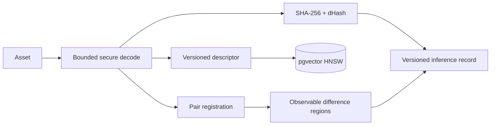

# Computer vision

The shared pipeline securely decodes images with Pillow, applies EXIF orientation, records safe metadata, computes SHA-256 and dHash fingerprints, produces a normalized 96-dimensional spatial/color descriptor, performs tenant-scoped retrieval, registers pairs by bounded translation search, and records measurable changed-pixel regions.

Every persisted comparison records asset IDs, model version, parameters, scores, alignment, regions, processing time, review state, and limitations. It is deterministic CPU inference—not a random score or external placeholder.

The current baseline is not OpenCLIP, local-feature geometric verification, a texture-authorship model, or a trained conservation segmentation network. It cannot identify authorship, hidden material deterioration, infringement, or liability. The synthetic evaluation verifies behavior only. Domain deployment requires licensed fixtures, calibrated thresholds, Precision/Recall/false-positive metrics, segmentation IoU where applicable, expert review, and a promoted model version.
