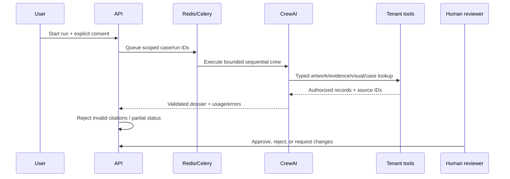

# CrewAI architecture

Vernis defines a separate narrow CrewAI team for every engine: 6 ArtSentinel agents, 5 ArtShield agents, 5 ConservaVision agents, 6 MuseGraph agents, 6 ArtValuate agents, and 5 ArtTransit agents. Each team ends in a structured Pydantic dossier.

Tools never receive unrestricted SQL or a user-selected organization. They are constructed with server-authorized organization, case, and run IDs. Evidence text is explicitly untrusted and cannot act as tool instruction. Agents have no delegation, use bounded iterations, preserve tool events, and do not store chain-of-thought.

External execution is disabled unless server configuration, an API key, and per-run consent all agree. Current external runs send authorized text/metadata and deterministic visual findings, not image bytes. A provider outage records a failed job without inventing a dossier. Human review remains mandatory.
