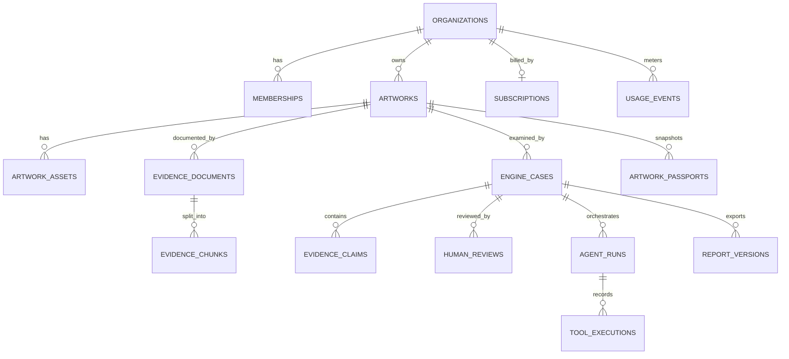

# Database design

Alembic is the application-schema authority. Additive migrations create the `vernis` schema and retain legacy `public` data. UUID primary keys, tenant-qualified foreign keys, explicit grants, indexes, and forced row-level security protect organization data.

Engine-specific tables keep domain state separate: copyright matches, condition inspections/findings, collection records/relationships, market comparables/valuation reports, and shipments/custody events. `vector(96)` stores the current visual baseline descriptor; `vector(1536)` stores private text feature-hash vectors. HNSW and full-text GIN indexes support retrieval.

Restricted evidence RLS allows owners, administrators, investigators, and reviewers only. Application checks additionally restrict writes by role and internal passport export. Stripe webhook IDs are unique for idempotency. No migration drops legacy tables.
