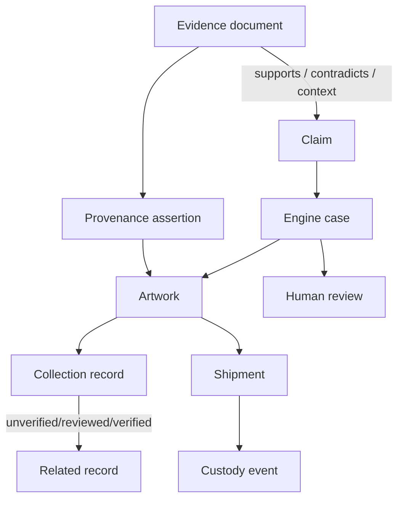

# Evidence graph

The initial evidence graph uses explicit relational edges rather than a separate graph database. Artwork, evidence, claims, provenance events, collection relationships, shipments, custody events, cases, and reviews retain stable IDs and source references.

Extraction never promotes text to historical truth. Provenance begins as `asserted`; collection relationships begin `unverified`; claims carry stance and review status. Public passport exports include approved workflow summaries and public evidence only. Internal exports additionally require a privileged role.
