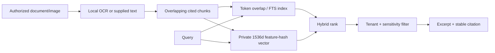

# Multimodal RAG

Evidence documents can reference private assets and store supplied or OCR-extracted text. Tesseract performs local OCR; extraction method and the unverified/error-prone boundary are persisted. Text is chunked with overlap and assigned stable passage citations.

The vector is a deterministic, private lexical feature hash—not a transformer semantic embedding. It improves token and bigram matching while avoiding external transmission, but it does not understand meaning like a trained embedding model. Queries are always tenant-filtered and optionally artwork-filtered before results are returned. Restricted evidence is role-filtered.

Claims store evidence IDs and source locators. Generated claims with invalid or inaccessible citations are downgraded to unresolved. Deleted or revoked evidence must be removed from future indexes and reports in a future retention workflow; no claim of semantic retrieval quality is made without a judged dataset.
