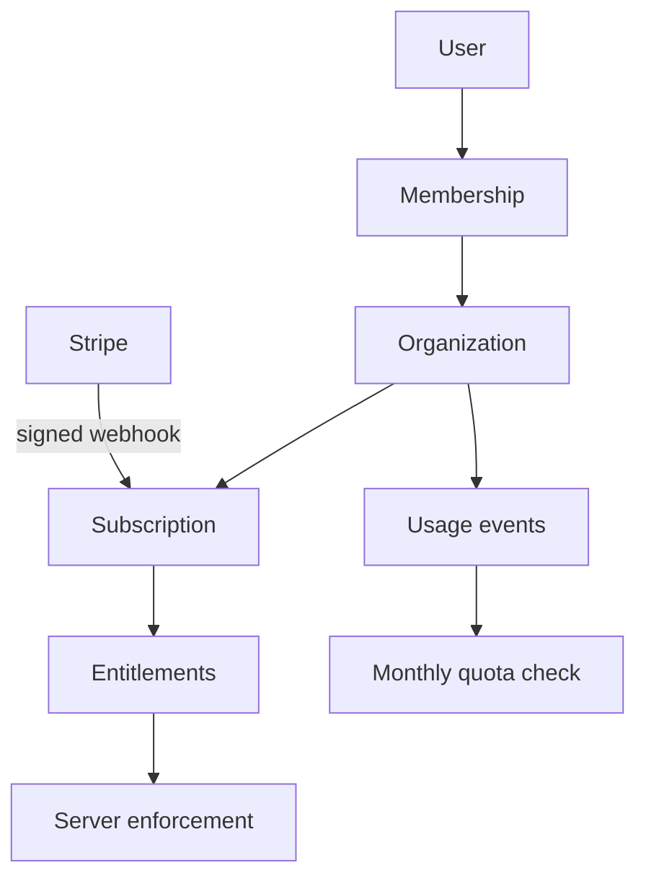

# SaaS architecture

Organizations are the billing, authorization, quota, and data-isolation boundary. Membership roles are owner, administrator, investigator, conservator, analyst, reviewer, and viewer. Module access and monthly workflow limits are represented as entitlements rather than UI-only plan checks.

Plans cover artist, professional, gallery, institution, and enterprise use. Checkout maps an organization and target plan to a configured Stripe Price. Signed webhooks reconcile customer/subscription state idempotently. Usage events record workflow creation and can support later storage/inference metering.

Missing Stripe keys produce an explicit unavailable response. They never create a fake checkout. Billing state does not weaken membership checks, and webhook metadata is validated back to a real organization.
