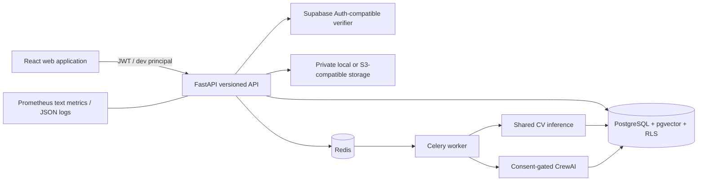
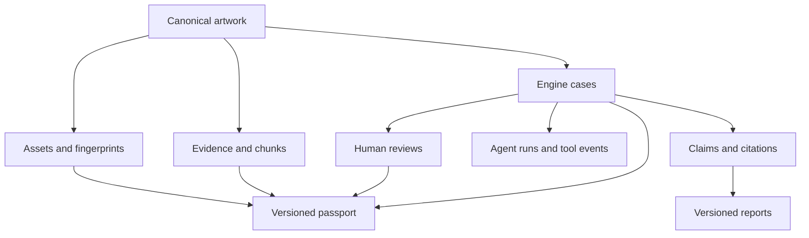

# System architecture

FastAPI is the primary policy boundary. Every organization query includes `organization_id`; PostgreSQL forced RLS is defense in depth for exposed tables. Assets are private and referenced by immutable IDs and SHA-256 hashes. Long-running agent work is queued in Redis and executed by a Celery worker.

Local CPU inference is the default. The deployment separates API and worker processes so optional higher-resource queues can be introduced without changing the data model. The original `/legacy` experience remains isolated during migration.
